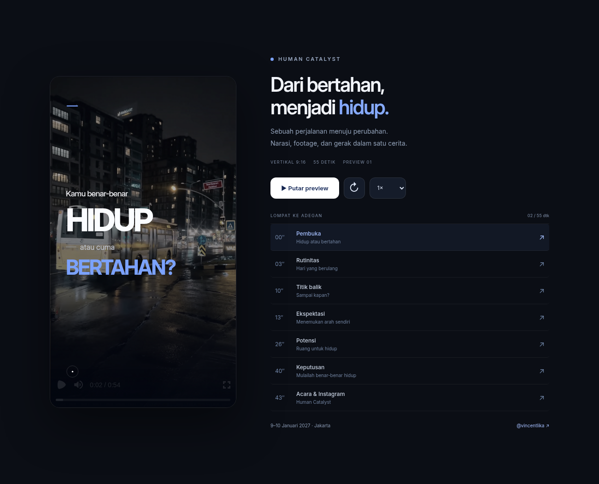

# Human Catalyst — Preview Video

Preview interaktif vertikal **9:16**, berdurasi sekitar **55 detik**, menggunakan audio narasi asli, footage nyata, motion graphic bergaya iPhone, serta teks penekanan pada bagian penting.

**[Unduh paket preview ZIP](https://github.com/rifandibatubara99-jpg/remootion/raw/refs/heads/main/preview/Human-Catalyst-Preview.zip)** · sekitar 9 MB

1. Unduh dan ekstrak ZIP.
2. Buka `Human-Catalyst-Preview.html` di Chrome atau Edge.
3. Tekan **Putar preview**. Gunakan kontrol jeda, kecepatan, atau tombol adegan untuk meninjau bagian tertentu.

Seluruh audio, footage, font, dan pemutar sudah berada di dalam HTML. File ini tidak membutuhkan instalasi. Ini merupakan preview untuk peninjauan, belum berupa MP4.

## Penutup acara

**Human Catalyst Live Transformation**  
**9–10 Januari 2027 · Jakarta**  
Info & pendaftaran: **[@vincentlika](https://www.instagram.com/vincentlika/)**

## Catatan preview

- Footage preview berasal dari sumber publik alternatif karena Pinterest tidak dapat diakses dari lingkungan pembuatan. Hak penggunaan aset aslinya belum diverifikasi untuk publikasi akhir.
- Cue teks diperkirakan berdasarkan naskah dan jeda audio; peninjauan sinkronisasi dengan narasi tetap dapat dilakukan melalui preview.
- Pemutaran audio, tujuh adegan, kontrol interaktif, tampilan ponsel, dan pemutaran tanpa koneksi setelah dimuat telah diuji di Chromium. Browser lingkungan memblokir navigasi `file://`, sehingga pengujian otomatis dilakukan melalui HTTP lokal.

SHA-256 paket ZIP: `1de1d7d79087d65a601a73a44152a32fa86c2ff84e526539ece34e45db54dae9`
